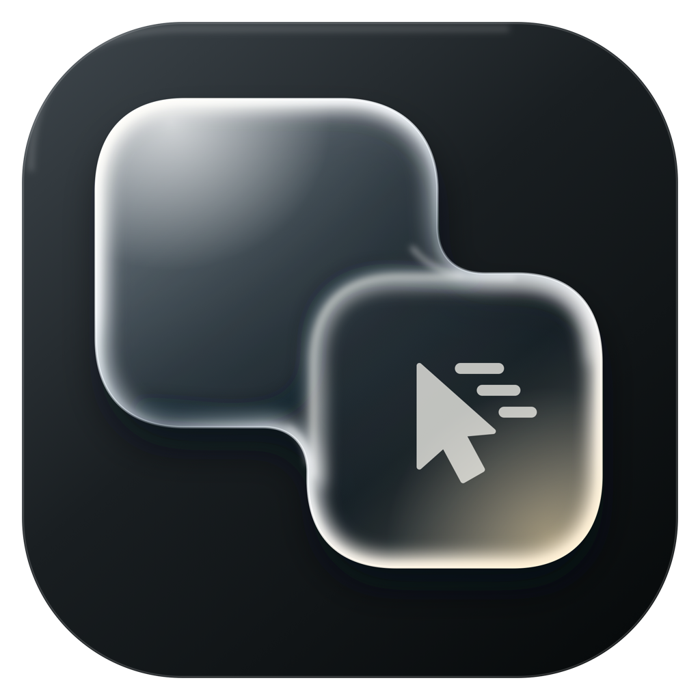

<p align="center"></p>

# Drag 2.0

Drag text and links between Mac apps. Hold a shortcut, pick a block, and drop it into a supported input at its existing caret.

**Apple Silicon only · Support focused on the latest macOS**

[Website](https://dragtwozero.com) · [Releases](https://github.com/maxim-kich/dragtwozero/releases) · [Legal & Privacy](https://dragtwozero.com/legal#app-privacy)

The app is **Drag 2.0 (Alpha)**. Version **0.0.2** is in preparation; no public app download is available yet.

The installation minimum is **macOS 13**. Official support is limited to the latest major macOS release once validated; older versions are best-effort and may work, but are unsupported. This candidate has been tested on **macOS 26.4.1**; validation on the current major release, macOS 27, is pending. Liquid Glass requires macOS 26 or later.

## Use

1. Open Drag 2.0 and grant Accessibility access when macOS asks.
2. Hold **Option + Command** and hover a paragraph or link.
3. Click the highlighted block and drag it into a supported input. Release to insert.

Settings lets you change the shortcut, appearance, haptics, and formatting. Optional **Buffer** holds one item for later. **Multi-select** and **Drag selected text** are under Experimental. All three are off by default.

Drag 2.0 never submits your text. Compatibility depends on each app’s Accessibility support. See the [usage guide and limitations](docs/usage.md).

## Build

On an Apple Silicon Mac with **Xcode 26 or newer** selected:

```sh
swift test
./scripts/build-app.sh
./scripts/verify-build.sh
open 'dist/Drag 2.0 (Alpha).app'
```

Local builds use an available development certificate or ad-hoc signing. They are not notarized distribution builds. See [development](docs/development.md) and [testing](docs/testing.md).

## Privacy and updates

Captured content stays on your Mac until you drop it into another app. Destination apps and system clipboard services have their own behavior. Optional Screen Recording permission allows small, local brightness samples for glass contrast; no frames are saved or uploaded.

There are no usage analytics. Update checks contact GitHub at most daily and can be disabled in About. Release checks send no captured content or installation identifier. [Details](https://dragtwozero.com/legal#app-privacy).

In About, choose **Check for Updates → Download & Install → Restart**. Updates use Sparkle with signed feeds and archives. Downloading, installing, and restarting require confirmation; restart waits until transfers, captures, and Buffer content are settled. See [updater setup](docs/updater.md).

## Contributing

Maintained by [Maxim Kich](https://github.com/maxim-kich). Focused bug fixes are welcome; discuss new features before starting. Read [CONTRIBUTING.md](CONTRIBUTING.md). Security reports: [SECURITY.md](SECURITY.md).

[MIT licensed](LICENSE).
